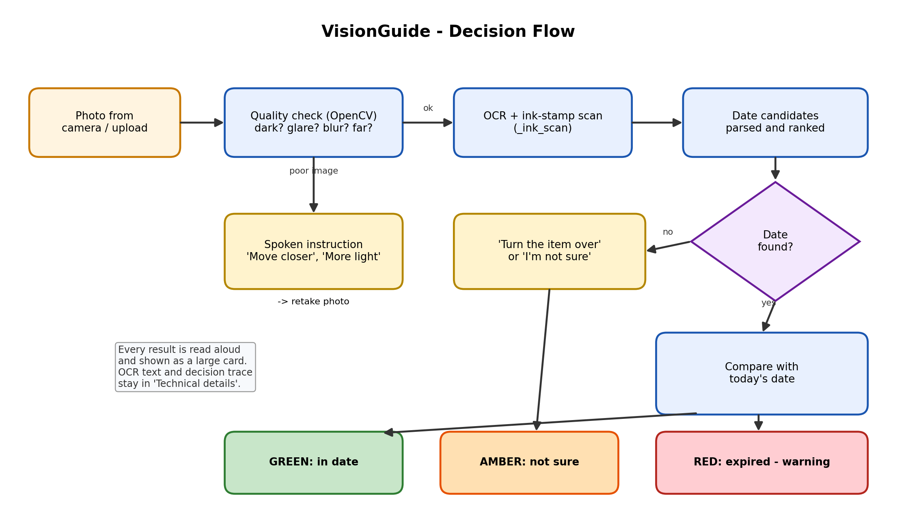
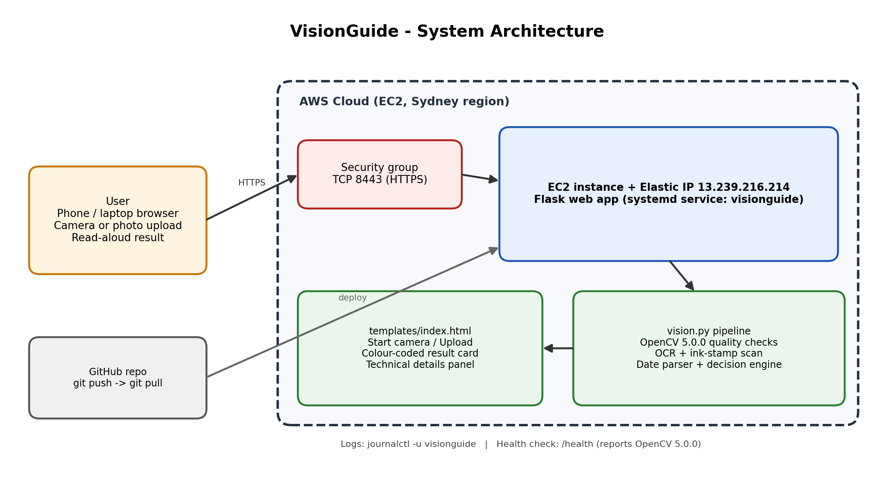

<div align="center">

# VisionGuide

### A Voice-Guided Camera Assistant for People with Low Vision


</div>

---

> **VisionGuide** helps people with low vision read the small printed expiry text on everyday items. Point the camera at a medicine strip, a food packet, a texts in bill or a form. VisionGuide tells you what it is, reads the important details out loud, and warns you if something has expired.

> If the photo is not good enough, it does **not** guess. It tells you what to fix: *"It is too dark"*, *"Move the phone closer"*, *"Tilt the phone, there is glare"*, or *"Turn the item over."*

---

## Try It

| | |
|---|---|
| 🌐 **Live demo** | https://13.239.216.214:8443/ |
| 🎥 **Demo video** | [YouTube link] |

> The demo uses a self-signed HTTPS certificate, so your browser shows a warning the first time. Click **Advanced → Proceed** to continue. The camera needs HTTPS (or `localhost`) to work.

---

## The Problem

Medicine strips, food packets and bills have very small text. Dates are often stamped on shiny foil, in tiny letters, at a slight tilt. For a person with low vision this is hard to read, and a misread **expiry date** on a medicine can cause real harm.

Most text-reading apps fail quietly. They return nothing, or the wrong thing, and never tell the person what to change.

---

## What VisionGuide Does

**1. Guides you to a good photo** (live camera, spoken instructions)
The app checks every camera frame for brightness, glare, blur and distance, and tells you what to change until the picture is clear.

**2. Reads what matters** (not everything)

| You choose | VisionGuide reads out |
|---|---|
| **Medicine** | Medicine name and expiry date |
| **Food expiry** | Expiry or best-before date |
| **Bill** | Total amount and due date |
| **Form** | The fields the form asks for |
| **Auto-detect** | Works out the type itself |

**3. Warns you clearly**
Every result is shown as one large card **and** spoken aloud:

| Colour | Meaning |
|---|---|
| 🟩 **Green ✔** | A date was found and read clearly |
| 🟨 **Yellow ⚠** | Not sure, or you need to move closer / turn the item over |
| 🟥 **Red ✖ EXPIRED** | The item has expired. *"Do not use it."* |

**4. Built for low vision**
- Large text and big buttons, with **A+ / A−** to change the size
- **Dark / Light** display (high contrast)
- **Read aloud again** button
- Works with screen readers
- Languages: **English** and **தமிழ் (Tamil)**

---

## Example

> *"Medicine: Metoprolol Succinate Extended Release. Expiry date: February 2028. Please confirm with your pharmacist."*

> *"Expiry date: December 2020. Warning: this item has expired. Do not use it."*

> *"I can see the expiry label but cannot read it. Bring the phone closer to the date and hold still."*

---

## How It Works



1. **Check the photo.** OpenCV measures brightness, glare, blur and how much of the frame the item fills. If something is wrong, you hear what to do.
2. **Read the text.** OCR (Tesseract) reads the printed words.
3. **Look harder if the date is missing.** If no date is found, VisionGuide changes how it looks. It tries a sparse read, zooms in on the `EXP` label, tilts the picture a few degrees, scans for coloured ink stamps, scans region by region, and rotates the picture.
4. **Check the answer.** A date is only accepted when several readings agree. A date printed on the `MFG` line is never mistaken for the expiry date.
5. **Decide and speak.** It compares the date with today and picks green, yellow or red. The result is shown and read aloud.

Every decision is written to a **decision trace** (see *Technical details* on the page), so you can see exactly why VisionGuide said what it said.

### Why it is careful
A wrong digit in an expiry date could say "expired" for a safe medicine, or "safe" for an expired one. So VisionGuide:
- accepts a date only when readings **agree**, and otherwise asks you to move closer,
- says **"I am not fully sure"** when confidence is low,
- never treats the manufacturing date as the expiry date,
- always adds **"please confirm with your pharmacist"** for medicines.

---

## AWS Architecture



| Part | What it does |
|---|---|
| **Amazon EC2** | Runs the Flask app |
| **Elastic IP** | Keeps the demo address fixed |
| **Security group** | Opens only the HTTPS port (8443) |
| **systemd service** | Restarts the app automatically and keeps logs (`journalctl -u visionguide`) |
| **Amazon S3** *(optional)* | Set `RESULT_BUCKET` to save each result as JSON |
| **JSON logs** | Every request is logged, ready for CloudWatch |
| **`/health`** | Shows the app is running and which OpenCV version (5.0.0) |

---

## Project Structure

```
visionguide/
├── app.py               # Flask server and routes
├── vision.py            # Image checks, OCR, date + medicine-name logic
├── templates/
│   └── index.html       # Accessible web page (camera, upload, result card)
└── docs/
    ├── diagram1_architecture.png
    └── diagram2_decision_flow.png
```

**Routes**

| Route | Purpose |
|---|---|
| `GET /` | The web page |
| `GET /health` | Health check and OpenCV version |
| `POST /analyze` | Quick photo-quality check for the live camera |
| `POST /read` | Full read of the item (name, date, amounts, fields) |

---

## Run It Yourself

**1. Install Tesseract (the OCR engine)**
```bash
# macOS
brew install tesseract
# Ubuntu / EC2
sudo apt install tesseract-ocr
```

**2. Install the Python packages**
```bash
pip install flask numpy opencv-python pytesseract boto3
```
*(`boto3` is only needed if you want to save results to S3.)*

**3. Start the app**
```bash
python app.py
```
Open **http://localhost:5001** and press **Start camera**, or use **Take or upload a photo**.

**4. How to get a good read**
- Pick the right type (for example **Medicine**) in the dropdown.
- Hold the item flat, with good light and no glare.
- Bring the date close, so `EXP` is about a third of the screen wide.
- For medicines, show the side with the **name** too.

---

## Deploy to AWS EC2

```bash
# on your computer
git add . && git commit -m "Update" && git push

# on the EC2 server
cd ~/visionguide
git pull
sudo systemctl restart visionguide
sudo systemctl status visionguide --no-pager
```
Then open the page and hard-refresh (`Cmd+Shift+R`).

---

## Honest Limits

- This is a **prototype**, tested on a small number of real items. It is an aid, **not** a replacement for checking with a pharmacist or another person.
- Results depend on photo quality. Text stamped on shiny foil is the hardest case.
- The medicine **name** is matched against a built-in list of common medicines. If the name is not in the list, or is cut off in the photo, VisionGuide says so instead of guessing.
- A full read can take 10–30 seconds on a small server.
- Languages: English and Tamil.

---

## What's Next

- Test with many more medicine strips, food packets and lighting conditions
- Larger medicine-name list
- More languages and date formats
- Testing with real low-vision users, and improving the spoken wording from their feedback
- CloudWatch dashboards and S3 storage (opt-in)

---

## Built With

Python · Flask · OpenCV 5 · Tesseract OCR (pytesseract) · NumPy · JavaScript (Web Speech API) · HTML/CSS · Amazon EC2 · Elastic IP · AWS Security Groups · systemd · Git & GitHub

---

<div align="center">

**VisionGuide** · Made so that nobody has to guess what a label says.

Built by **Sagarisha** · MIT License

</div>
